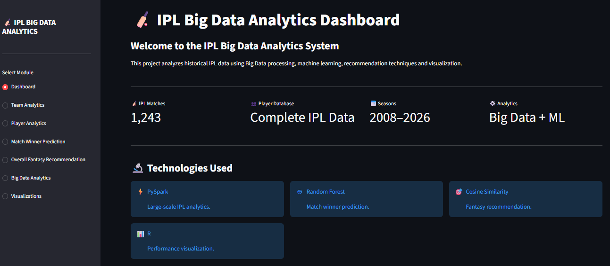
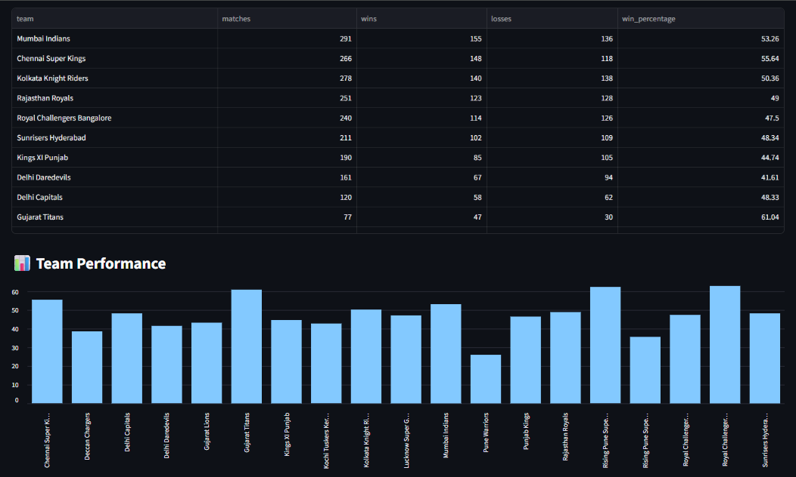
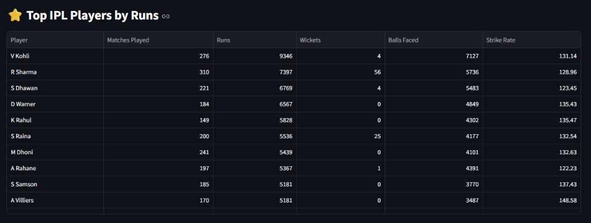
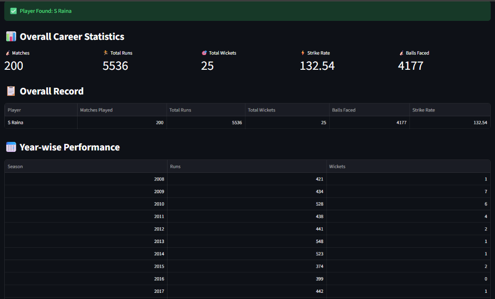
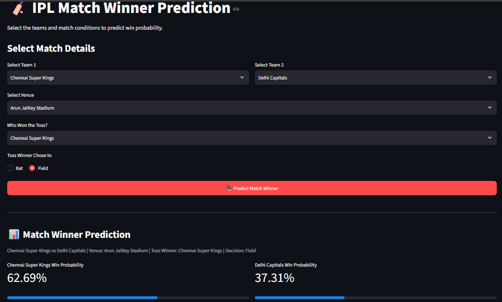
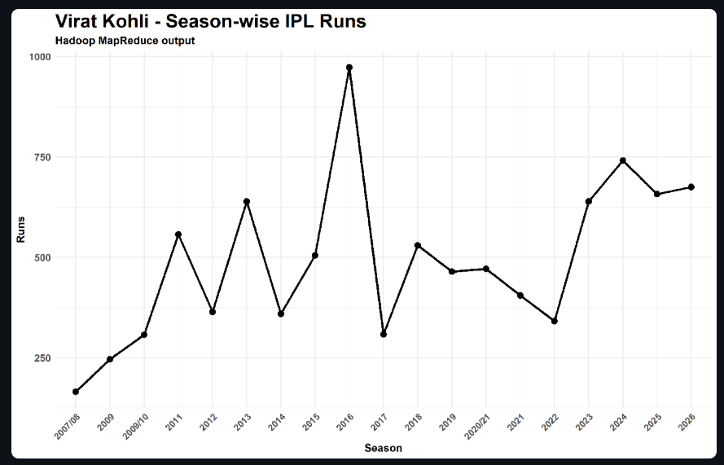

# IPL Big Data Analytics

An interactive dashboard for exploring IPL match history, player and team performance, match predictions, fantasy recommendations, and big-data analytics.

## Screenshots

### IPL Analytics Dashboard
An overview of the project, match dataset, seasons, and technologies.



### Team Performance
Compare team match records, wins, losses, and win percentages.



### Top IPL Players
Explore leading players by runs, with additional performance statistics.



### Player Career Analytics
View a player's career totals, records, and season-by-season performance.



### Match Winner Prediction
Choose teams and match conditions to see the predicted win probabilities.



### MapReduce Visualization
Visualize season-wise player performance from the MapReduce output.



## Features

- Interactive Streamlit dashboard with team and player analytics.
- IPL match winner prediction interface.
- Fantasy player recommendations.
- Big-data analytics views for PySpark and MapReduce results.
- Performance visualizations, including R-generated charts.
- Historical match data in JSON format.

## Technologies

- Python, Streamlit, and Pandas
- Scikit-learn and NumPy for analytics scripts
- PySpark for distributed data processing
- R, ggplot2, dplyr, and readr for visualizations

## Project Structure

```text
.
├── app.py                 # Streamlit dashboard
├── data/                  # IPL match data in JSON format
├── docs/images/           # Screenshots used in this README
├── output/                # Analytics results and generated charts
├── python/                # Data processing, analytics, and recommendation scripts
└── r/                     # R visualization scripts
```

## Run the Dashboard

The dashboard uses the JSON match files in `data/` and reads available analytics results from `output/`.

1. Install Python 3 and open a terminal in the project folder.
2. Create and activate a virtual environment (PowerShell):

   ```powershell
   py -m venv .venv
   .\.venv\Scripts\Activate.ps1
   ```

3. Install the dashboard dependencies:

   ```powershell
   python -m pip install streamlit pandas
   ```

4. Start the dashboard:

   ```powershell
   streamlit run app.py
   ```

Streamlit will print a local URL (usually `http://localhost:8501`) to open in your browser.

> Some analytics scripts in `python/` and `r/` require additional packages and, depending on the script, a configured PySpark/Hadoop environment.

## Data

The `data/` folder contains 1,243 IPL match files in Cricsheet JSON format. See [`data/README.txt`](data/README.txt) for dataset notes. Cricsheet provides the [format documentation](https://cricsheet.org/format/json/) and [available downloads](https://cricsheet.org/downloads/).
